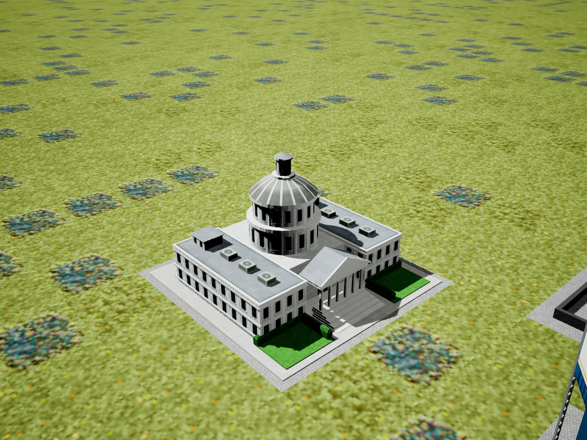
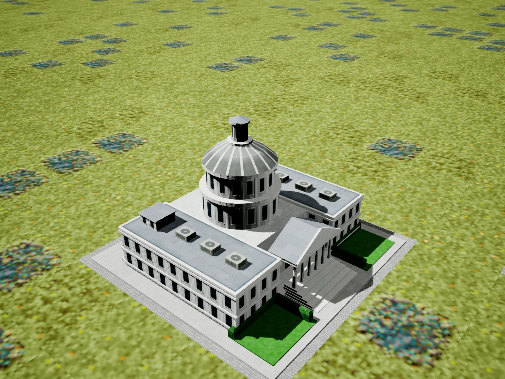
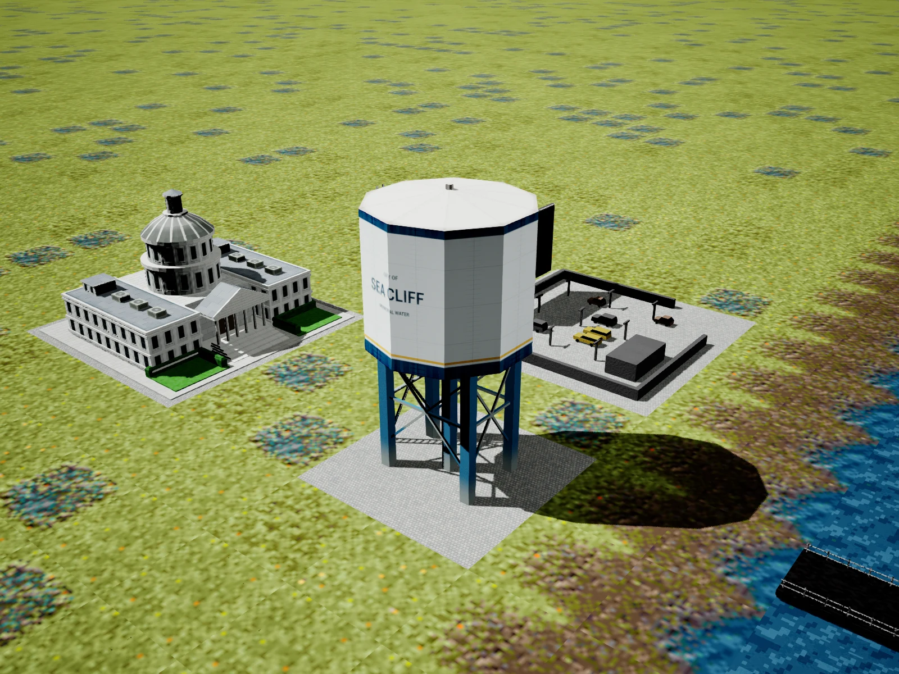
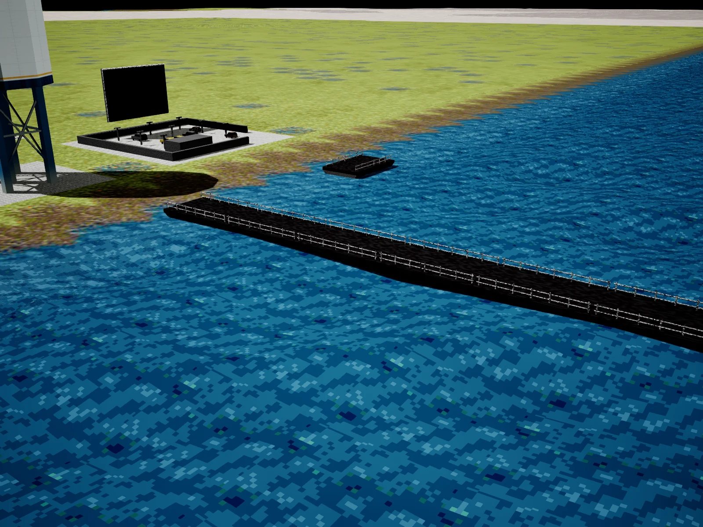

# Civic buildings, waterfront and controller review

October 15, 2026. Included in [v1.0.18](Releases/v1.0.18.md), authorized for publication after validation.

## Appearance

- **City Hall:** CH208 uses pale stone wings, textured recessed windows and pilasters,
  carved cornices, a broad staircase, a six-column pedimented entrance, two stepped
  rotunda tiers, a shallow flared crown and a narrow upper lantern. Two lawns and
  raised clipped hedges flank the entrance. The supplied
  SC2000 reference determines the design and the original three-tile footprint remains.
  Windows follow the existing city day/night lighting controls.
  Gray lead roof sheets, fine seams, stone coping and narrow gutters surround six
  low AC housings and two small rooftop service structures. Fan grilles, louvers,
  facade columns, window surrounds, crown ribs and foliage detail use the shared
  material. The new reference pass reduces the mesh from 11,918 to 3,622 vertices
  and from 5,778 to 1,682 front-facing triangles (70.9% fewer triangles), including
  the new equipment and hedges. Material slots and draw calls are unchanged.
- **Piers:** both AP223 orientations place the walking deck 40 cm above the local
  rendered water at the default wave setting, instead of about two metres. Larger
  waves increase clearance only enough to keep the deck above their crest. The
  placement transform is shared by rendering, bounds and collision. Land piers and
  road bridges retain their existing placement.
- **Water towers:** all WT235 placements use the improved ivory tank with city-name
  lettering, steel supports, cross-bracing, ladder, shallow sealed lid and roof vent.
  The lid and its rim use neutral metal; the blue band stays on the vertical tank wall.

## Controls

Catalog left/right navigation stays on the aircraft row. Down is required to highlight
Upgrades or Apache; Up returns to the aircraft row. Keyboard arrows, controller D-pad
and analog-stick navigation share the same rule.

A plain Select/View/Back press cancels an open Tools, Dispatch or passenger panel and
advances one flight-camera view. The controller binding passes the press through to the helicopter pawn. It also exits the remote-taser sight so the camera
change is visible. Repeated/held events do not skip views. The intentional modifier
plus Select Radio shortcut remains available.

Manually ejecting a police officer or medic now starts a strict 15-second gameplay
boarding cooldown. It applies to every police state, the cabin and harness, and
restarts on each successful drop. Final patient handoffs no longer let medics bypass
the delay. Patients can still be loaded during the crew cooldown. Normal automatic
disembarking does not start this manual-drop timer.

## Performance diagnostics files

`Launch-With-Performance-Diagnostics.cmd` writes under
`%LOCALAPPDATA%\SimCopterRemake\Saved\`:

- `Logs\Performance-Diagnostics.log` is the text log.
- `Profiling\Witness-Performance_<timestamp>.utrace` is the Unreal Insights timing trace.
- `Crashes\` contains crash evidence when a crash produces it.

On this computer the base directory is `C:\Users\riche\AppData\Local\SimCopterRemake\Saved\`.

## Documentation download size

The 20 existing screenshots were re-encoded from PNG to WebP at their original dimensions:
48,045,343 bytes became 4,520,116 bytes, a **90.6% reduction**. Text-heavy cheat guides
use lossless encoding with pixel equality checked. Scene captures use quality 88.
Markdown references were updated; the original PNGs remain in the ignored scratchpad.
The four review images above are also WebP.

## Implementation and validation

`Tools/Unreal/BakeCivicPresentation.py` creates the City Hall material and rebakes the
water tower material under the existing always-cooked `Generated/CityAtlas` directory.
Run with UnrealEditor-Cmd, `-run=pythonscript`, `-AllowCommandletRendering` and the script
path. `Tools/CompressDocScreenshots.py` performs the documentation conversion.

The runtime landmark mesh is built once and reused through the existing city instancing
path. Binary RGB finish tags avoid the difference between static-mesh sRGB color packing
and procedural-mesh linear packing. Outward normals are preserved on the two-sided legacy
triangles. No per-building ticks, render targets or extra material slots were added.

The first candidate passed 75 related automation cases covering camera input routing,
persistent menus, remote-camera handoff, Catalog navigation, city placement,
building collision/demolition and radio behavior. The latest reference/crew pass
passed 32 focused cases, including the reproduced early-boarding failures, all
police states, medic handoffs, repeated drops, passenger behavior and City Hall
day/night rendering. One test recorded an unrelated background connectivity timeout.
Editor and Shipping builds passed. The fresh Shipping cook succeeded;
its manifest contains both landmark materials, both maps and all six original runtime
data directories. The packaged executable hash matches the new Shipping binary.

[Original validation receipt](validation/CivicWaterfrontReviewResults.json) records
the first candidate's checks, hashes and fixture warnings. The
[City Hall detail validation](validation/CityHallDetailReviewResults.json) records
the previous texture pass. The latest [reference and crew review validation](validation/CityHallReferenceAndCrewReviewResults.json)
records the simplified landmark, real day/night rendering, strict crew return delay,
builds, regression tests and fresh Shipping cook.
The updated local playable build is at
`Docs/scratchpad/cityhall-reference-2026-10-15/ReviewPackage/Windows/SimCopterRemake.exe`
in the development checkout. Interactive flight and a physical controller remain part
of manual validation. Final release checks are recorded in [WindowsRelease118Results.json](validation/WindowsRelease118Results.json).
