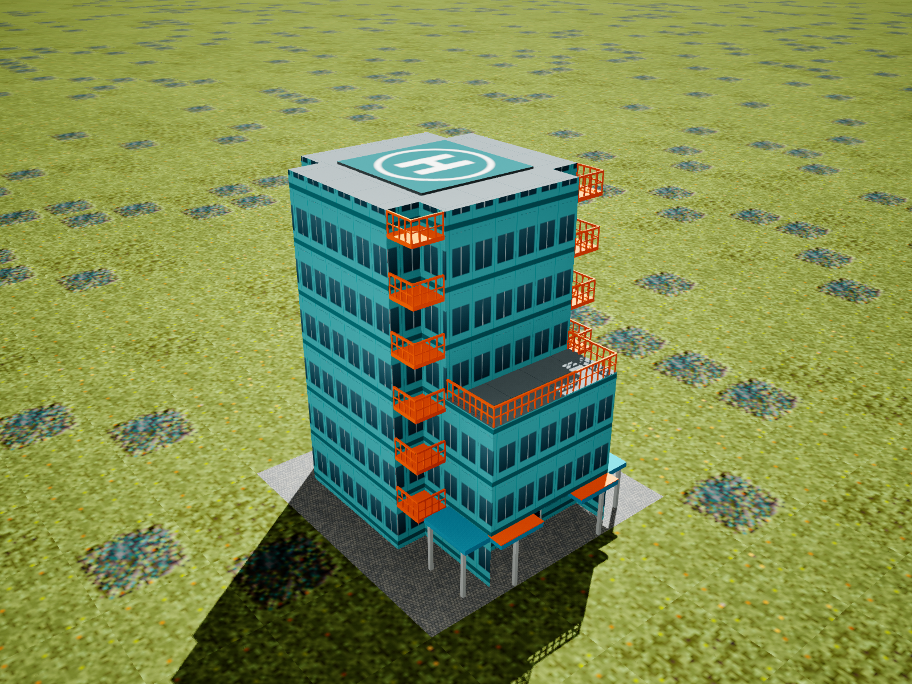
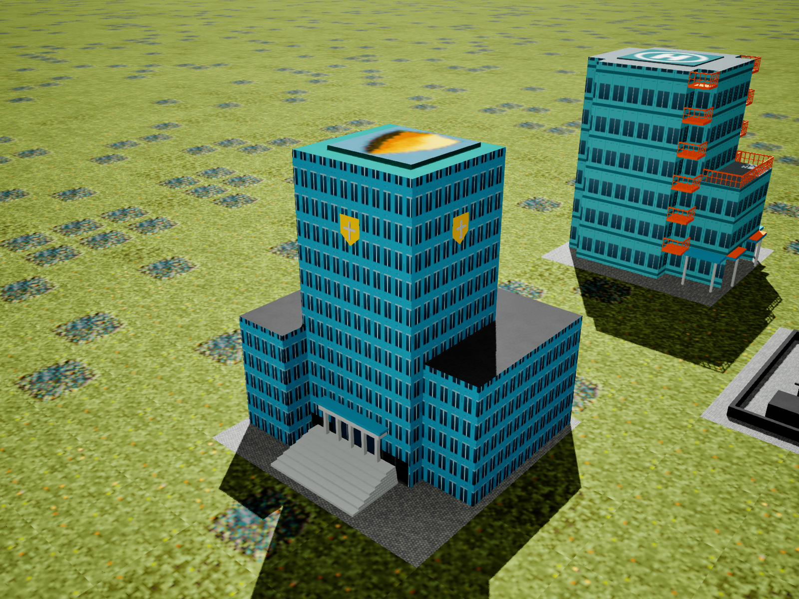
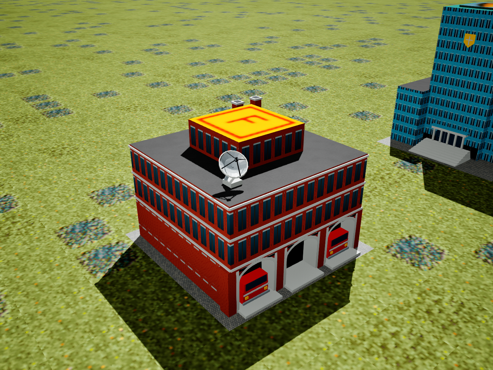

# Emergency headquarters reference update — October 18, 2026

The supplied SimCity 2000 screenshot guides the façades and entrances. The remake's existing roof surfaces, helipads, texture coordinates and beacon markers are retained.

- **Hospital (HO209 / D1):** turquoise cladding, six levels of orange corner balconies with open railings, aligned window bands, and a recessed ground-floor entrance under a supported canopy. The low entrance wing's roof remains at its existing height.
- **Fire station (FS211 / D3):** the original unstretched height, red brick façades, three recessed arched apparatus bays, two decorative parked engine fronts, a tilted dish with pedestal/feed supports, and two chimney stacks. The equipment stays beside the existing upper landing roof.
- **Police station (PO210 / D2):** the existing tall centre and stepped wings, blue glazed façades, gold shields, a broad staircase and columned entrance. The previously requested police height remains.

The partially visible globe/park structure in the reference is the **Launch Arcology (Launch Arco)**. Its dome contains the distinctive rock formations, trees and blue pond. The [arcology reference gallery](https://ss1.xrea.com/sc2.s27.xrea.com/sc2/data/arco.html) identifies and illustrates it.

`SimCopterEmergencyBuildings.h/.cpp` authors each model once per city build, then uses the existing instanced rendering and mesh collision paths. `MaxisMeshLibrary.cpp` now stretches only police; the fire source data stays at its shipped height so downstream bounds, collisions and roof queries agree. A tagged material section distinguishes added details from the hospital roof override. The new material shares the existing night fade, brightness, seed and window-density controls.

`Tools/Unreal/BakeEmergencyPresentation.py` creates `M_EmergencyDetails`. `CreateHospitalPresentation.py -HospitalFacadeOnly` updates the hospital cladding without rebaking either hospital roof material. Both assets live in the existing always-cooked CityAtlas folder. No packages, save formats, gameplay dispatch, responder behavior or per-building ticks were added.

The automation cases `SimCopter.EmergencyBuildings.RoofsHeightAndGeometry` and `SimCopter.EmergencyBuildings.CityCollisionAndPreview` verify retained roof vertices/UVs/materials, original fire height, lot bounds, material binding, hospital canopy clearance, a recessed fire bay and actual rendered day/night controls. The offscreen images below are Unreal captures, not illustrative mockups.

The gallery was refreshed from the v1.0.21 offscreen run and includes the later
[hospital balcony/canopy corrections and artwork option](EmergencyArtworkOptionsOctober18.md).

Build logs, before-edit source copies, an exact source diff, render captures and installation backups are under `Docs/scratchpad/emergency-hq-2026-10-18/`. Final validation and installation status is recorded in `Docs/validation/EmergencyHeadquartersOctober18Results.json`.

Editor, Shipping and Development builds and the Shipping cook/package succeeded. All 32 selected automation cases passed on the final source with D3D12 offscreen rendering. The three daytime captures and the police window-emission checks were inspected. The initial test build needed its test-friend declaration; the subsequent and final builds passed. Existing synthetic-fixture mobility and graphics-plugin startup warnings remain.

Installed 7 changed runtime files in `C:\SimCopterRemake\SimCopter Remake v1.0.1\Windows`, with verified backups and matching SHA-256 hashes. All 183 protected map/save/config/media files were unchanged. Both installed executable variants survived separate hidden 30-second startups with isolated profiles. No interactive flight/gameplay playtest or publication update was performed.
