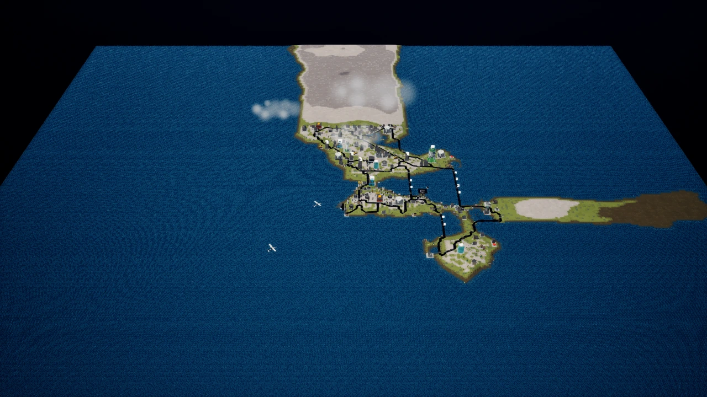
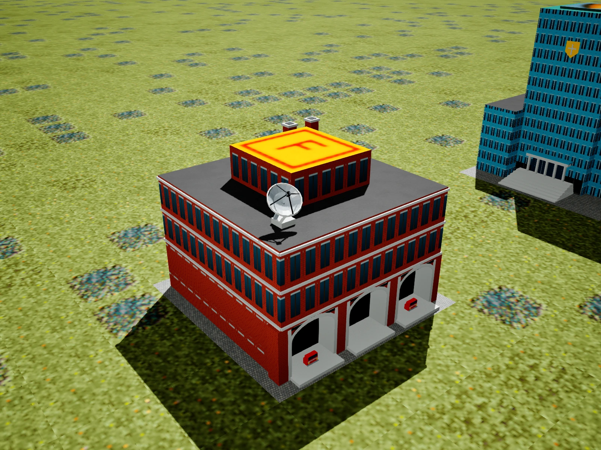
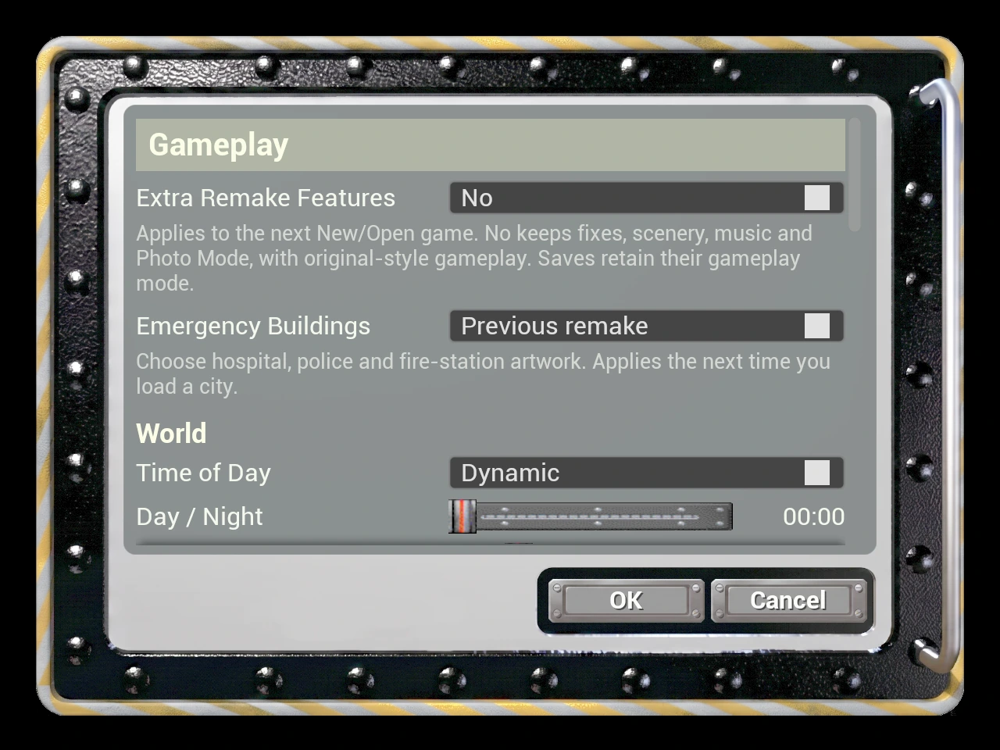

# Fog, station engine scale and career preview playback

## Tour appearance

The v1.0.22 local fog volumes overlapped into opaque rounded cloud masses. The requested revision uses lower radial extinction (0.018 rather than 0.08 at the reference radius), lower height extinction (0.35 rather than 0.8), more horizontal spacing and less vertical variation. The result is a translucent, soft-edged fog bank. Height extinction remains nonzero because Unreal multiplies radial and height coverage. Both densities are required. No nonuniform scale is used: Unreal reduces local fog volume scale to its maximum axis.

Per-city bank locations, the lower Calebopolis placement, imported-map terrain seeds and clear Metropolis remain. The separate visible owner, presentation-clock drift, idempotent start and completion/skip/teardown cleanup are preserved. No gameplay weather or random stream is changed.

## Station engines

The gameplay fire engine is CARFIRET, dispatched through the original model table. Excluding discarded type-11 headlight cards, its body is 10.5468 GEO units wide, 12.3052 high and 34.6202 long. The vehicle conversion is 65536 / 2621.44 * 0.25 = 6.25 cm per GEO unit, the same scale used by the building generator.

FS211’s decorative noses were 31 GEO units wide including the bumper. Scale only their vertices uniformly by 0.35 around the front centre and existing bottom contact. Their resulting bumper width is 10.85 units (67.81 cm), versus 65.92 cm for CARFIRET; painted cab width is 10.15. These are short decorative front sections, so matching the full truck’s length is not appropriate. UVs, materials, colours and proportions are retained; gameplay trucks and building collision outside these details are unchanged.

The existing geometry test compares the resulting painted cab width directly with CARFIRET’s opaque geometry and verifies the ground position. It also retains the original roof, footprint, materials, night-lighting and previous-artwork checks.

## Career map animation

`CloseScreen()` closes the career media players. `GetCareerCityMovieBrush()` previously returned an existing brush immediately, even if its player was closed. A returning player could therefore see a frozen/cleared map. The cached path now reopens closed/error players and resumes paused ones, while leaving opening or playing movies alone. It retains the same brush/texture so existing Slate references remain valid.

These original CITY0_S–CITY29_S movies are part of the normal career presentation, independent of the optional gameplay policy. The offscreen playback regression opens all three initial choices with Extra Remake Features off, leaves and returns with it still off, repeats with it on, then returns to off. Each visit must decode changing pixels for all three maps and cross an actual loop boundary. The test uses the shipped MP4s, not mocked time or static screenshots.

The baseline regression passed the first visit with extras off, then failed on the second visit because the cached player never resumed. With the fix, all three movies decoded changing frames and crossed a loop boundary on all four visits (off, off, on, off).

## Building style option

**Game Menu > Options > Gameplay > Emergency Buildings > Previous remake** restores the previous hospital, police and fire station on the next city load. This remains separate from Extra Remake Features. Other updated landmarks are unaffected.

## Validation

Final results are recorded in [the v1.0.23 release receipt](validation/WindowsRelease123Results.json). Screenshots come from offscreen Unreal rendering. No manual flight or controller playtest is claimed.
