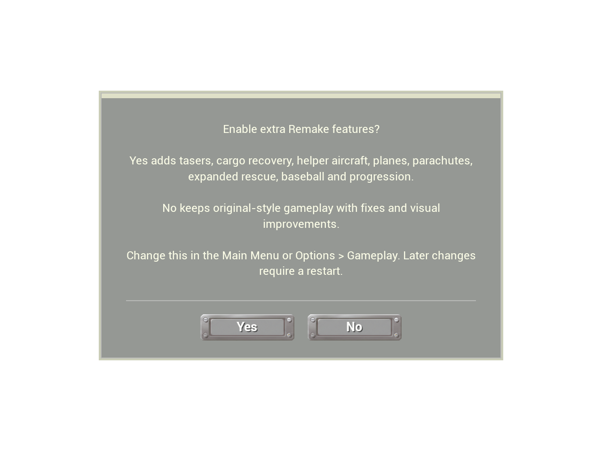
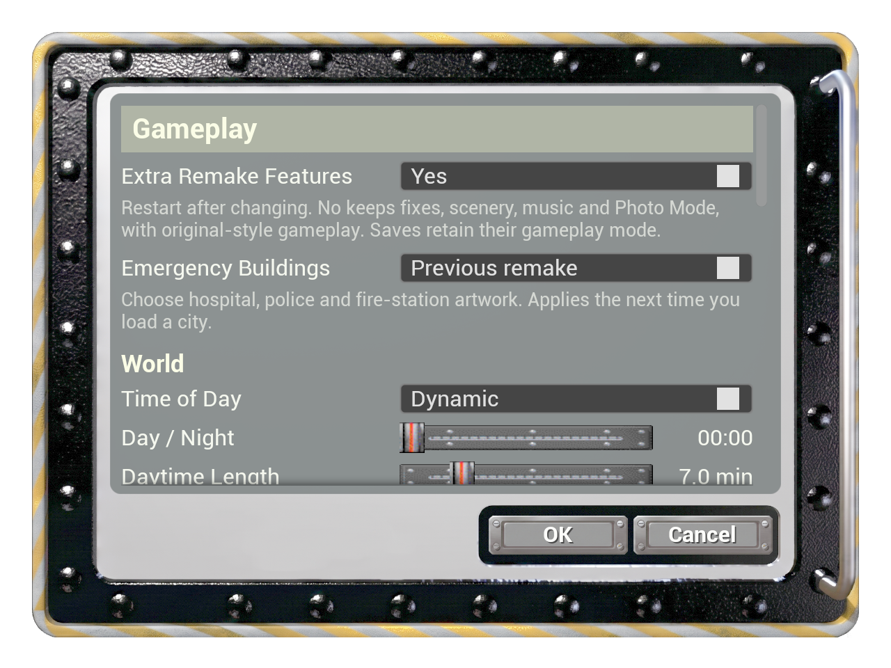

# v1.0.21 — optional Remake gameplay, pilot retrieval and building updates

This release adds a persistent choice of gameplay features, fixes an aircraft
binding error that can stop repeated pilot retrieval, and publishes the completed
October 18 landmark/power-plant/causeway work. All previous fork fixes remain
included.

## Choose the gameplay you want

At first start, answer **Enable extra Remake features?** The choice is also in the
main menu and **Game Menu > Options > Gameplay**. Later changes require a restart.
No retains fixes and visual improvements while disabling the 13 requested groups:
handheld/remote tasers, direct arrests, capture cages, vehicle recovery, helper
helicopters, flyable planes, parachutes/pilot retrieval, expanded medical/body
recovery, suspect photos/witness reports, full baseball games, custom progression,
additional custom-city controls, and aircraft/hangar presentation.

Ordinary police, medical and rescue missions remain. Photo Mode, city scenery,
radio, general controls, safe mission placement and User-map job limits remain.
[Exact feature policy and save compatibility](../RemakeFeatureChoice.md).

## Bug fixes in this release

- **Pilot retrieval after repeated exits:** deferred pilot startup could replace
  its assigned helicopter with a nearer parked aircraft. The original helicopter
  then cancelled retrieval because the pilot no longer referred to it. Preserve
  the assigned aircraft and ignore hidden/helper aircraft during fallback search.
  The baseline test reproduced this three times. Repeated fatal respawn, boarding,
  and the actual `I love my helicopter` cheat have regression coverage. Explicit
  autopilot OFF and Extra Remake Features: No still disable retrieval as intended.
- **Safe mode changes:** keep the running world's mode fixed until restart. Cancel
  restores the pending choice. New saves record their mode; an incompatible load
  explains how to switch without changing the save. Old saves use Yes.
- **Causeway boat traps:** boat placement, routes, normal movement and rotor-wash
  movement now check the swept hull against the causeway strip. Existing trapped
  boats relocate only to a valid position, preserving mission records. Road
  surfaces stay unchanged and aircraft clearance is checked beneath the deck.

## Buildings and the previous-style option

The selected-building update covers 35 entries and the causeway: corporate HQ,
arcologies, civic/special buildings, non-wind power plants, construction and
military structures. Shared materials add masonry, metal, glazing, timber and
landscape detail. Original footprints, warning beacons, smoke behavior and road
surfaces are preserved. Windows use the existing night controls.
[Full scope, gallery and measurements](../SelectedBuildingsOctober18.md).

For the hospital, police station and fire station, **Game Menu > Options > Gameplay
> Emergency Buildings > Previous remake** restores their previous styles on the
next city load. This is independent of Extra Remake Features and is limited to
the emergency buildings.

[Hospital, police and fire-station gallery](../EmergencyHeadquartersOctober18.md).

## Earlier fixes retained for upstream review

The proposed upstream contribution also includes the fork's earlier fixes. These
are retained in both gameplay modes where the underlying original feature exists:

- **Traffic:** corrected stale helicopter-heading probes and route-endpoint lane
  guidance that stranded cars on Heven/custom-map intersections; police pursuit
  pacing, burglar contact handling, and repeated pursuit-credit prevention.
- **Mission reliability:** immediate traffic-jam reporting, validated transport
  pickup/destination clearings across User maps, bounded three-job pacing, saved
  bucket/harness selection, hospital delivery and medic boarding corrections.
- **Recovery and collision:** fatal falls return to the cockpit after the timer;
  surviving aircraft retain fuel/damage/location; destroyed aircraft recover at
  an available airport pad. Swept aircraft collision, bounded turbo descent,
  below-world recovery and hangar fleet recall remain.
- **Input and performance:** mouse-look displacement no longer scales with frame
  time; cached NPC poses and paced population creation reduce measured stalls;
  controller selection, radio navigation, reverse taxi and scrollable logs remain.
- **Audio and rendering:** original radio sequencing/shuffle rules and on-foot
  playback, live brightness changes, hospital night windows, marina water/shore
  corrections and preserved roof artwork remain.

See [October playtest fixes](../PlaytestFixesOctober18.md),
[Heven reproduction](../HevenTrafficIntersections.md),
[fork history](../ForkChanges.md), and the individual validation receipts for
before/after evidence and limitations. Unresolved older crash or visual reports
are not represented as fixed by this release.

## Validation and downloads

Editor, Shipping and Development builds passed. All 611 tests in the full suite passed, followed by 99 offscreen regression cases on affected systems after the final policy/catalog fixes. The focused regressions, fresh Shipping cook/package and both isolated 30-second packaged startups also passed. See [validation receipt](../validation/WindowsRelease121Results.json).

Screenshots are actual Unreal offscreen renders. There was no interactive flight,
physical-controller or manual listening playtest. The full Windows archive is the
game; the optional Development archive is a diagnostic overlay. Keep existing
maps/saves/configuration when updating. Archive hashes are in SHA256SUMS.txt.
