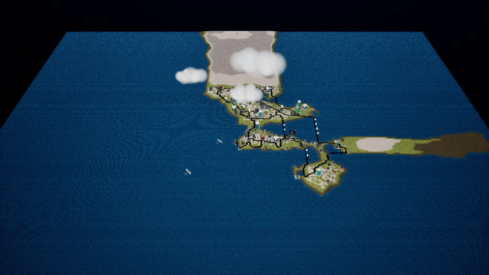

# v1.0.22 — saved game options and map-specific tour clouds

The Extra Remake Features choice is now available every time you select New Career Game, Open Career Game, New User Game or Open User Game. The Game Options page has a remembered toggle, Back and Continue. Continue applies it before the selected city/save picker, without an application restart. Existing installations no longer depend on a one-time prompt flag.

Game Menu > Options > Gameplay edits the same preference for the next New/Open game. The current city's rules remain stable, and Cancel restores the previous preference. Saves still require their recorded gameplay mode; mismatch guidance now points to the Open Game toggle. The original five-item main menu is restored.

Tours now include low, thick cloud banks with positions and sizes adapted from each career island's original preview movie. Imported cities receive repeatable layouts adapted to their terrain. Metropolis keeps its clear preview. These are visual adaptations, not exact movie reconstructions. Clouds drift on presentation time, pause with the tour, and disappear on completion, skip or level teardown without changing gameplay weather or random sequences.

The v1.0.21 pilot-retrieval correction and all previous bug fixes remain included. Extra gameplay remains optional. Updated building graphics are retained in either mode, and **Game Options > Gameplay > Emergency Buildings > Previous remake** restores the earlier hospital, fire and police station styles on the next city load.

[Detailed behavior](../SessionOptionsAndTourClouds.md) · [Full feature policy and retrieval fix](../RemakeFeatureChoice.md) · [Building gallery](../SelectedBuildingsOctober18.md)

## Validation

Editor, Shipping and Development builds passed. All 611 full-suite cases passed, plus 66 offscreen regression cases including all 30 career tours and the revised menus. Fresh Shipping cook/package and both isolated 30-second packaged startups passed. See [validation receipt](../validation/WindowsRelease122Results.json).

No interactive flight, physical-controller or manual listening playtest was performed. Rendered evidence comes from actual Unreal widgets and city scenes.

The upstream PR remains on hold for user review.
