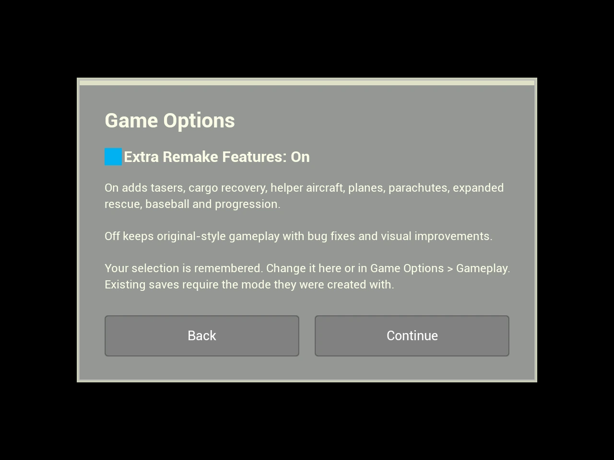

# Optional Remake features and repeatable pilot retrieval

Select **New Career Game**, **Open Career Game**, **New User Game**, or **Open User Game** to see **Game Options** before the city/save picker. The **Extra Remake Features** toggle remembers its last position, including when you go Back. Continue applies that choice to the selected game flow without restarting the application. This screen appears on every visit, including existing installations.

**Game Menu > Options > Gameplay > Extra Remake Features** edits the same saved preference. During a city, it applies to the next New/Open game; current missions and equipment retain their rules. Cancel in Options restores the previous preference. Emergency-building artwork is an independent option and remains available in either gameplay mode.

## Features controlled by the choice

| Group | Yes | No |
| --- | --- | --- |
| Handheld taser and direct arrests | Aim, stun, carry and deliver detained suspects | Disabled; ordinary police missions remain |
| Helicopter remote taser | Scope, fire, pursuit and its controls | Disabled and unavailable in the catalog/tool wheel |
| Capture cage | Equipment, controls and capture/delivery | Disabled and hidden |
| Vehicle recovery missions | Recovery sites and stalled-car/boat recovery | No recovery sites or jobs |
| AI helper helicopter | Unlock, dispatch and mission work | No helper or helper-dispatch entry |
| Flyable transport airplanes | Airport plane and flight controls | No flyable plane; ambient city aircraft remain |
| Parachuting and pilot retrieval | Parachute, unattended landing and automatic pilot recovery | Disabled; ordinary exits and fatal-fall recovery fixes remain |
| Expanded medical/body recovery | Additional incident casualties, body collection, extra service crews, police medical assistance and manual medic/patient handoffs | Original medevac/injury missions and one hospital roof medic remain |
| Suspect photographs and witness reports | Live suspect picture and spoken report | Disabled |
| Full ambient baseball games | Innings, scores and rosters | Earlier ambient baseball behavior |
| Custom-city progression | Score/equipment stages and aircraft-sized groups | Original difficulty-driven mission selection |
| Additional custom-city controls | Progress-stage override, mission-frequency control, native city browsing and download links | Original city list, difficulty and mission weights remain |
| Aircraft and hangar presentation | Revised aircraft paint/windows/occupants, animated medic portrait, reconstructed hangar and equipment previews | Earlier aircraft palette, textured hangar shell and printed equipment catalog |

The safe full-map mission-placement fixes and three-active-job limit still apply
to User cities in both modes. Rendering, radio, controller navigation, and other
fixes are independent of this setting.

## Save compatibility

New saves record the active gameplay mode in save format 6. Loading a save with
the opposite mode explains which choice to select on the Open Game options screen before
loading. It does not modify the save or partially restore its world. Older saves
default to Yes because they predate the choice and may contain the fork's added
people, equipment and aircraft. Keep the original save when trying another mode;
start a new city in that mode.

## Pilot retrieval bug

An exiting pilot is assigned the helicopter they actually left before deferred
spawning finishes. The pilot's `BeginPlay` discovery then searched again and could
replace that binding with a closer parked helicopter. Retrieval checks the binding
on every update; a mismatch cancels the original aircraft's recovery. Repeated
exit/respawn or cheat boarding could therefore appear to disable retrieval even
though the saved autopilot switch was still on.

The fix preserves a valid assigned aircraft during discovery. Fallback discovery
also skips hidden and support aircraft. Death recovery and the helicopter cheat
continue to clear the previous recovery and retire the old pilot, so the next exit
starts a fresh attempt. The user's explicit autopilot OFF choice remains respected.

The baseline regression reproduced the binding loss and stopped movement three
times near another aircraft. Plain repeated fatal respawn and boarding passed the
baseline; they are not claimed as independently reproduced causes. Tests now cover
those paths, the nearby-aircraft case, the actual `I love my helicopter` parser and
controller action, and disabled retrieval. No interactive flight playthrough is
claimed.

## Building artwork is a separate option

**Game Menu > Options > Gameplay > Emergency Buildings > Previous remake** restores
the earlier hospital, fire-station and police-station styles on the next city load.
**Updated** selects the revised styles. Cancel restores the entry selection.
This existing option applies to those emergency buildings; it does not revert the
entire city or the separately updated landmarks and power plants.

These are actual Unreal offscreen renders of the game widgets and city meshes.
See the [complete building gallery](SelectedBuildingsOctober18.md) and
[release validation](validation/WindowsRelease121Results.json).
