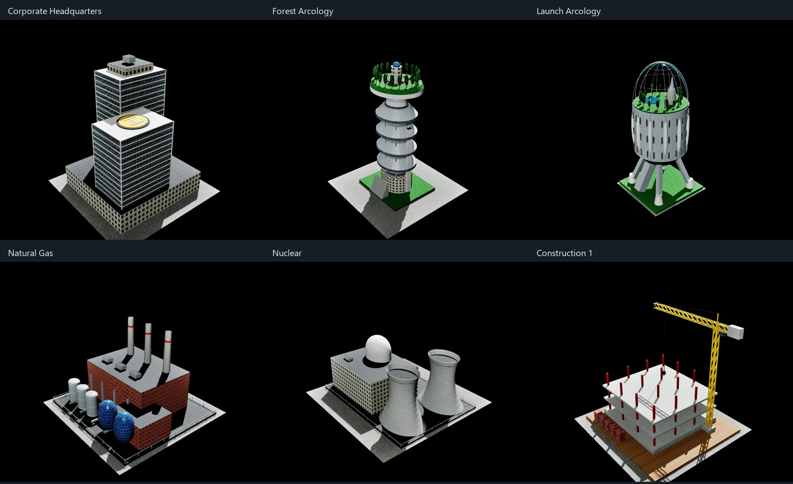

# Selected SimCity 2000 building reference update — October 18, 2026

The preceding emergency-artwork task completed in v1.0.20 before this task began. Source baseline: `Docs/scratchpad/selected-buildings-2026-10-18/before/`.

## Reference and scope

The [Timigi comparison gallery](https://www.timigi.com/Stuff/Archive/simcopter/buildings.html) supplies the original SC2000 sprite beside the SimCopter model. The [OpenCity2k file-format research](https://github.com/OpenCity2k/SC2k-docs/blob/master/sc2%20file%20spec.md) and the local original GEO/dispatch establish the identity mapping. Reference downloads stay in the ignored scratchpad.

There are 20 included Special Buildings: Big Park, Braun Llama Dome, Church, College, Darco Arcology, Desalinization Plant, Fire Dept, Forest Arcology, Launch Arcology, Library, Mayor's House, Museum, Plymouth Arcology, Police Dept, Prison, School, Statue, Water Pump, Water Treatment and Zoo. Hospital, Marina, City Hall, Stadium, Small Park and Water Tower are excluded.

Also included: Corporate Headquarters; both hydro variants plus gas, oil, nuclear, solar, microwave, fusion and coal plants; Causeway; Military Control Tower; Missile Silo; Construction 1/2; Crane. Wind remains excluded. Construction 1/2 are CA194/195 (XBLD C2/C3), not CA136/137. Military tower is AP226; civilian AP225 remains unchanged.

## Implementation contract

- Authored meshes fit approximately the original GEO size; existing tile footprints and global model scales remain.
- Original warning beacons retain their colors and shared blink schedule; anchors follow the new tower/rim geometry. Chimney smoke markers retain effect class 1. Solar has no smoke emitter.
- Shared materials provide filtered masonry, metal seams, glazing, window frames, solar cells, timber and landscape detail. Windows use the existing day/night controls. Launch has a separate translucent biosphere.
- Models enter the existing city instancing, collision, demolition and merged-rendering paths. No new runtime per-building ticks or asset dependencies.
- Fire/police retain their approved roof artwork and persisted Updated/Previous choice, with modest additional entrance/lintel/downpipe detail. Hospital remains untouched.
- Causeway road polygons and UVs stay exact. Slender support piers occur every eight tiles (32 metres at the default city scale). Navigation excludes the causeway strip, samples hull clearance during ordinary movement and rotor drift, and relocates pre-existing trapped boats without discarding their mission records.

## Validation

The full suite passed all 603 cases (559 without warnings, 44 with warnings). The subsequent offscreen suite passed 54 cases (51 without warnings, three with warnings), followed by a final three-case selected-building run without warnings. The final runs include geometry/scope, original beacon retention, smoke class, real city materials, merged rendering, helicopter clearance at the measured road height, boat route/placement/drift exclusion, trapped-save relocation, and night lighting controls. Editor, Shipping and Development builds succeeded. A fresh Shipping cook/package succeeded and contains both new materials. Seven installed runtime files were backed up and hash-verified; all 183 protected map/save/config/media files were unchanged. Both installed executables passed isolated 30-second startup checks. See [validation and installation receipt](validation/SelectedBuildingsOctober18Results.json).

The 34 replacement GEO variants measured 80–102% of original X width, 75–102% of original depth, and 85–112% of original height. Tile ownership and city scale did not change. Fire/police retain the preceding authored silhouettes.

Visual inspection covered all 35 building entries, the causeway, and selective night windows. The underpass sweep uses a 4.4 × 4.4 × 1 m envelope, above terrain and below the original road deck. This is offscreen rendering and automated collision validation; no interactive flight playtest was performed.

[Gallery 1](images/selected-buildings-october18/gallery-1.webp) · [Gallery 2](images/selected-buildings-october18/gallery-2.webp) · [Gallery 3](images/selected-buildings-october18/gallery-3.webp) · [Causeway](images/selected-buildings-october18/causeway.webp) · [Selective night windows](images/selected-buildings-october18/corporate-night-selective.webp)

## Identity map

The allowlist is GEO identity, not a substring match on model names. XBLD IDs below are decimal.

| Family | XBLD IDs | GEO IDs |
| --- | --- | --- |
| Corporate Headquarters | 187 | 10 |
| Church, Desalinization, Library, Museum, School | 247, 250, 245, 212, 214 | 20, 21, 23, 24, 27 |
| Crane, Military Control Tower | 224, 226 | 141, 143 |
| Plymouth, Launch, Braun | 251, 254, 255 | 151, 152, 153 |
| Construction 1 and 2 | 194, 195 | 213, 214 |
| Hydro 1/2, gas, oil, nuclear, solar, microwave, fusion, coal | 198, 199, 201–207 | 217, 218, 220–226 |
| Prison, College, Statue, Water Pump | 216, 217, 219, 220 | 228, 229, 230, 231 |
| Mayor, Water Treatment, Missile Silo | 243, 244, 249 | 241, 242, 244 |
| Forest, Darco | 252, 253 | 245, 246 |
| Big Park variants, Zoo | 213, 218 | 324/326, 367 |
| Fire, Police (existing authored models extended) | 211, 210 | 227, 0 |
| Causeway orientations and slopes | 73–80 | 247–250 |

`SimCopterSelectedBuildings.cpp` owns the authored geometry. `BakeSelectedBuildingPresentation.py` regenerates the two generated materials in `/Game/Generated/CityAtlas`, an always-cooked directory. The 16 opaque finishes use four binary vertex-color channels so both instanced and merged meshes select identical finishes. The transparent Launch dome has its own material section. Models are built once per identity during city rebuild, with no additional per-building ticks.

The boat change is separate from aircraft impact classification: ordinary water queries still report water beneath a causeway, while boat placement, route selection, normal movement and rotor-wash movement exclude it. Hull samples cover the swept segment, including large frame displacements. A failed relocation leaves the existing hull and mission state intact.
